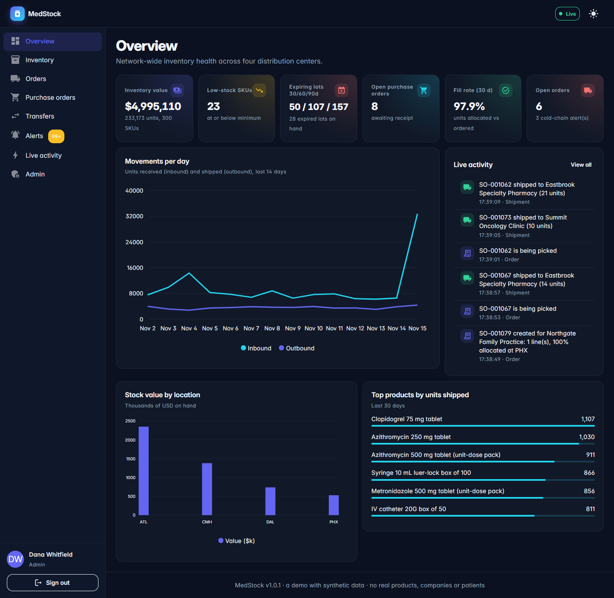
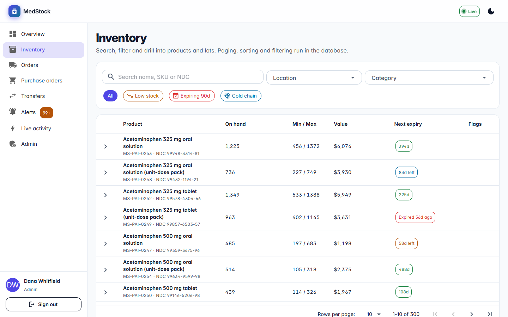
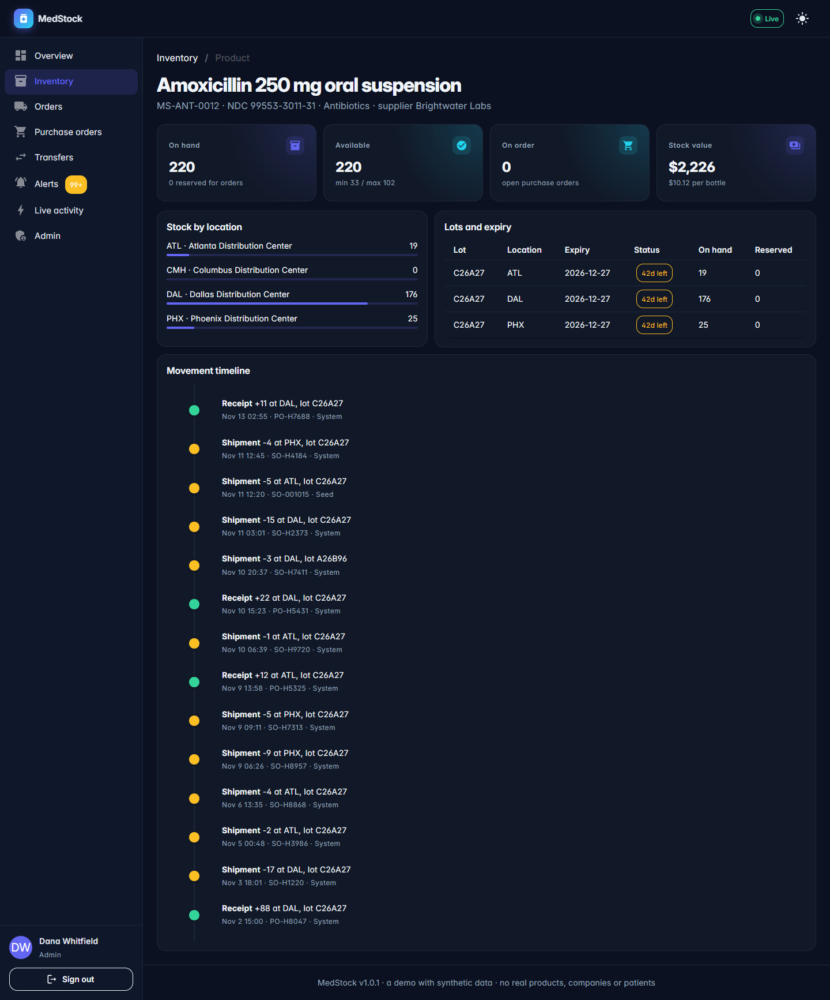
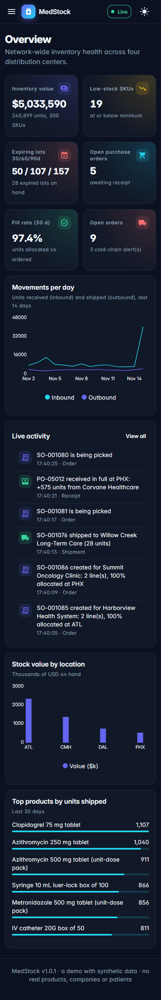
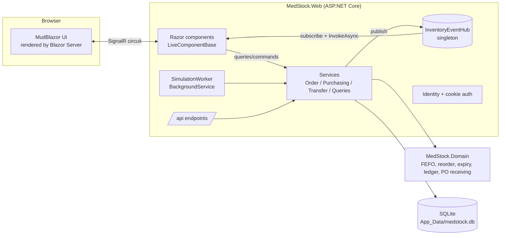

# MedStock

A healthcare-style **inventory and order management system** with real-time updates, built as a portfolio project. Everything is a demo with **synthetic data**: no real products, companies or patients.

> Blazor Web App (Interactive Server) on .NET 11, MudBlazor, EF Core + SQLite, ASP.NET Core Identity, SignalR live updates. No JavaScript written by hand, no CDNs, no external libraries beyond MudBlazor.

## Screenshots

| Overview (dark, desktop) | Inventory (light, desktop) |
| --- | --- |
|  |  |

| Product detail (dark, desktop) | Overview (dark, 390px phone) |
| --- | --- |
|  |  |

## Features

- **Overview**: KPI tiles (inventory value, low-stock SKUs, lots expiring within 30/60/90 days, open POs, fill rate, open orders), MudChart charts (movements per day, stock value by location), top products, and a live activity feed.
- **Inventory**: MudDataGrid with server-side paging, sorting and filtering (search, location, category, low stock, expiring, cold chain) and lot drill-down per row.
- **Product detail**: stock by location, lot and expiry table, movement timeline.
- **Orders**: create with MudForm validation, **FEFO** (first-expiry-first-out) allocation across lots, pick and ship flow, cancel and re-allocate. **Edit lines** (add, remove, change quantity) until picking starts: all reservations are released and FEFO runs again, so nothing stays reserved by accident. Admin-only delete of cancelled orders that never moved stock.
- **Purchase orders**: reorder suggestions from min/max levels (counting stock on order), auto-generated POs per supplier **and manual POs** (supplier, warehouse, lines), edit quantities (never below what was received), cancel before receipt, receive (full or partial) to book new lots.
- **Transfers** between locations (reserved stock cannot move; cold chain only to cold-chain sites) with **reversal by compensating movements**.
- **Master data (full CRUD)**: Products, Warehouses, Suppliers and Customers, each a MudDataGrid with search plus MudDialog create/edit forms with validation and a confirmed delete. Records that history refers to (stock, lots, orders, POs, movements) cannot be deleted; they are **deactivated** instead, which hides them from pickers, suggestions, alerts and the simulator while history stays readable.
- **Append-only ledger**: stock movements are never edited or deleted. Cancelling or reversing is always a new compensating movement, and `/api/ledger/verify` replays the whole history against current stock.
- **Role-based permissions, enforced in the services** (not only by page attributes): Admin (everything, plus order delete and demo reset), Warehouse Manager (all create/edit/delete/deactivate, cancel, receive, reverse), Picker (pick and ship), Viewer (read only).
- **Alerts**: low stock, expiring lots (30/60/90 days, expired), cold-chain temperature excursions.
- **Real time**: a background simulator creates orders, ships them, receives POs, transfers stock and raises alerts every few seconds. Every connected user sees dashboards, grids and the feed update live. Toggle it from the app bar or the Admin page.
- **Auth**: Identity with seeded roles (Admin, Warehouse Manager, Picker, Viewer), one-click "Try the demo" sign-in (plain form posts), role-based authorization, Admin-only "Reset demo data".
- **Ask MedStock (AI)**: an agentic, read-only inventory assistant powered by Claude (see below), plus an **AI briefing** card on the Overview.
- Responsive, dark/light (cookie based), accessible (skip link, labels, focus states), zero build warnings.

## Ask MedStock: agentic assistant (Claude)

`/assistant` (nav entry "Ask MedStock", any signed-in role) is a chat where you ask questions in natural language, for example "Which cold-chain lots expire in the next 30 days at MIA?", "What should I reorder this week?" or "Why is SO-001042 short?". Claude runs a **tool-use loop** (Messages API over plain `HttpClient` + `System.Text.Json`, no SDK or extra library, streaming responses) and calls **read-only tools** backed by the existing query services. The tools used are shown as small chips under each answer. The Overview has an **AI briefing** card that generates a short daily operations briefing from the same tools.

Tools (all read-only, validated inputs, row caps of 25, compact JSON; no mutating service method is reachable):

| Tool | Backed by | Purpose |
| --- | --- | --- |
| `search_products` | `InventoryQueries.SearchProductsAsync` | find products by name, SKU or NDC |
| `get_stock_by_product` | `InventoryQueries.GetProductAsync` | totals, warehouses, lots and expiry, on order, recent movements |
| `list_expiring_lots` | `InventoryQueries.GetExpiryAlertsAsync` | lots expiring within N days, warehouse and cold-chain filters |
| `list_low_stock` | `InventoryQueries.GetLowStockAsync` | products at or below minimum |
| `get_order` | `OrderService.GetAsync` | one order with lines, allocated lots and shortfall |
| `list_open_orders` | `OrderService.ListAsync` | open or filtered orders, shortfall only |
| `list_reorder_suggestions` | `PurchasingService.GetSuggestionsAsync` | what to reorder, supplier and cost |
| `list_alerts` | `InventoryQueries.GetAlertSummaryAsync` / `GetExcursionsAsync` | alert counts and cold-chain excursions |
| `get_kpis` | `InventoryQueries.GetKpisAsync` | network KPIs |

Safeguards: answers only from tool results (never invented numbers), max 6 tool rounds per question (then a final answer is forced without tools), questions limited to 500 characters, last 10 turns of history, 90 s timeout, friendly errors that never expose API details, per-user rate limit (`Claude:HourlyLimit`, default 20 per hour) and a global daily cap (`Claude:DailyLimit`, default 200). The system prompt and tool definitions use prompt caching. Authorization is server-side (`[Authorize]` page plus a signed-in user required by the service).

Configuration:

| Setting | Default | Notes |
| --- | --- | --- |
| `Claude:ApiKey` (env `Claude__ApiKey`) | none | Without it the page and the briefing card show "AI features need an API key"; nothing else is affected |
| `Claude:Model` | `claude-haiku-5-5` | |
| `Claude:DailyLimit` | 200 | questions per UTC day, all users |
| `Claude:HourlyLimit` | 20 | questions per user per hour |

Locally: `dotnet user-secrets` or `Claude__ApiKey=...` before `dotnet run`. In production set the repository secret and deploy:

```
gh secret set ANTHROPIC_API_KEY -R MiguelAlonso1/medstock-inventory
```

The deploy job writes `Claude__ApiKey` into the published `web.config` `<environmentVariables>` only when the secret is non-empty (XML-escaped, never printed). This happens in the deploy job on the downloaded copy, not in the build job, because the build artifact of a public repository is downloadable and must never contain the key.

## Architecture



Writes are serialized through a `WriteGate`, saved, then announced on the event hub with topic flags; components reload only when a relevant topic fires. The business rules live in `MedStock.Domain` (no EF or ASP.NET dependencies) and are unit-tested in isolation.

```
MedStock.slnx
  src/MedStock.Domain        pure rules (FEFO, reorder, expiry, ledger, PO receiving, order workflow)
  src/MedStock.Web           Blazor app, EF Core, Identity, services, simulator, endpoints
  tests/MedStock.Domain.Tests   xUnit unit tests
  tests/MedStock.Web.Tests      xUnit + WebApplicationFactory integration tests
```

## Tech stack

.NET 11, Blazor Web App (Interactive Server), MudBlazor 9.13, EF Core 11 + SQLite, ASP.NET Core Identity, SignalR (via Blazor Server), xUnit + `Microsoft.AspNetCore.Mvc.Testing`. Inter font self-hosted.

## Run locally

Requires the .NET SDK 11.

```
dotnet run --project src/MedStock.Web
# http://localhost:5120  (the SQLite database is created and seeded on first start)
dotnet test MedStock.slnx
```

Demo accounts (also available as one-click buttons on the sign-in page), password `MedStock-Demo-2026!`:
`admin@medstock.demo`, `manager@medstock.demo`, `picker@medstock.demo`, `viewer@medstock.demo`.

Master data pages live under `/manage/*` and are visible to Admin and Warehouse Manager.

Settings (`appsettings.json`): `Simulation:Enabled`, `Simulation:IntervalSeconds`, `Demo:OneClickLogin`, `ConnectionStrings:Default` (defaults to `App_Data/medstock.db`).

## Tests

- Domain: FEFO allocation, reorder point and min/max suggestions, expiry classification, ledger (no negative stock, replay verification), PO receiving (partial, over-receipt), order workflow, CRUD rules (delete vs deactivate, validation, order line edit and delete rules, PO edit/cancel rules, transfer reversal and compensating ledger entries).
- Service tests (real services over a throw-away SQLite file): create/edit/delete/deactivate for every master data type, delete blocking, hidden-when-inactive, order line edit FEFO reallocation without leaked reservations, manual/edit/cancel PO, transfer reversal ledger integrity, role denials for every mutation, simulator with inactive and user-created data.
- Integration (real app, throw-away SQLite file): authentication and antiforgery, every demo role, role restrictions (403/401), FEFO allocation through `POST /api/orders`, pick and ship by a Picker, ledger consistency, PO receive (full, partial, forbidden), cold-chain rules, Admin-only reset, HTTPS redirect.

## Deployment

Target: Windows/IIS shared hosting, deployed over FTPS by `.github/workflows/ci-cd.yml` (same safety design as the portfolio site: target-folder validation, write probe, `app_offline.htm`, `mirror -R` without `--delete`, always-run cleanup, smoke test, concurrency).

1. Repo **variables**: `FTP_SERVER_DIR` (site folder, e.g. `inventory/`), `SITE_URL` (optional, default `https://inventory.alonsomiguel.com`), `DEPLOY_ENABLED=true` to turn deploys on. **Secrets**: `FTP_SERVER`, `FTP_USERNAME`, `FTP_PASSWORD`.
2. The workflow publishes self-contained `win-x86` (the host may not offer .NET 11); `web.config` is out-of-process with WebSockets enabled. Enable the WebSocket Protocol feature in the hosting panel.
3. Smoke test: `https://inventory.alonsomiguel.com/health`.
4. **Database**: SQLite is created and seeded on first start in `App_Data/`. The folder must be writable by the app pool. `App_Data/*.db*` is excluded from the publish output and from the FTP mirror, so later deployments never overwrite live data. The schema is created with `EnsureCreated` (no migrations); its version is stored in SQLite's `user_version`. When a release changes the schema (`DemoSeeder.SchemaVersion`), the first start logs a warning, drops and recreates the demo database and reseeds it (demo users are recreated too), so an existing `App_Data` upgrades by itself.
5. Concurrent users share one simulator and one database; this is intentionally a single-instance demo.

## License

MIT. See [LICENSE](LICENSE).
